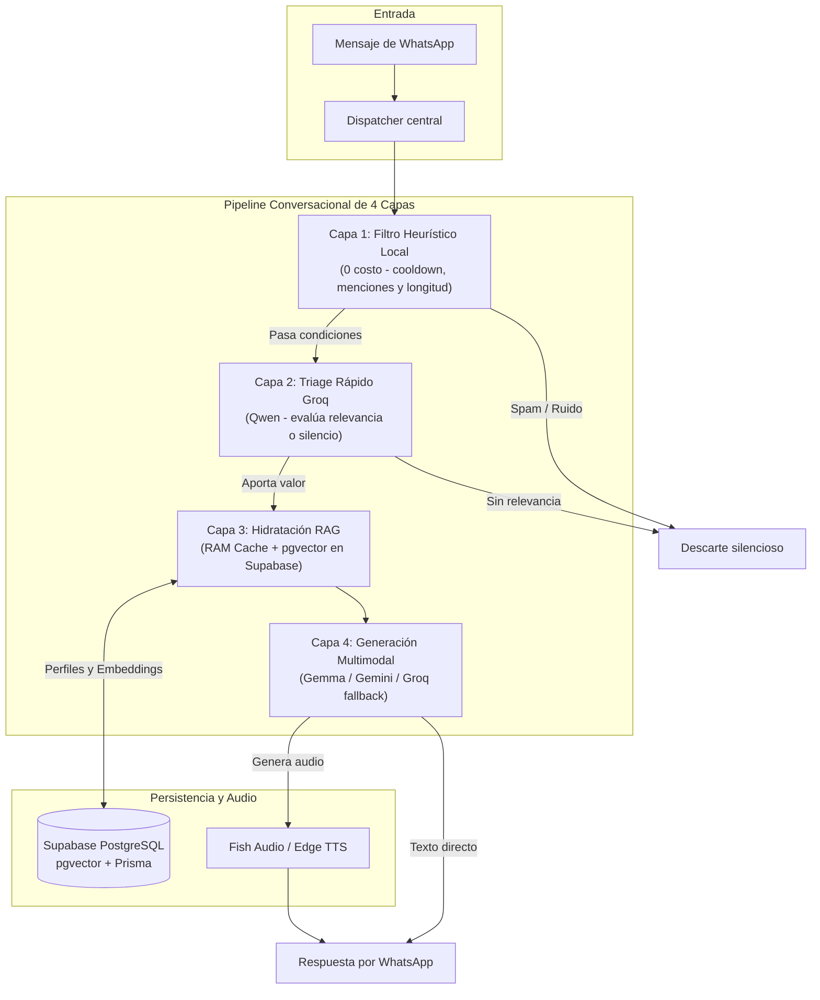

# empy-bot

Bot para WhatsApp desarrollado en TypeScript y Node.js sobre la librería Baileys. Cuenta con memoria semántica persistente, clonación de voz neuronal, procesamiento multimodal, utilidades grupales, minijuegos y un sistema de economía urbana.

> [!NOTE]
> **Disponibilidad actual y hoja de ruta:**
> Por diseño de seguridad (*fail-closed*), el bot opera actualmente en una comunidad privada principal mediante la variable `GROUP_JID`.
> 
> **Próximamente disponible:**
> - **Soporte multi-grupo:** Instalación y configuración en múltiples grupos de WhatsApp en simultáneo, con balances de economía, hechos y configuraciones independientes.
> - **Atención por mensaje directo (DM):** Interacción uno a uno por privado con memoria contextual personal y acceso a utilidades y herramientas.

---

## Características principales

- **Memoria persistente y búsqueda vectorial:**
  - Base de datos relacional PostgreSQL en **Supabase** gestionada a través de [`prisma/schema.prisma`](./prisma/schema.prisma).
  - Conexión optimizada mediante pooler transaccional (`DATABASE_URL`) y conexión directa para migraciones (`DIRECT_URL`).
  - Búsqueda semántica de mensajes y contexto previo mediante la extensión `pgvector`.
  - Perfiles de usuario con roles, apodos, hechos conocidos y preferencias.
  - Síntesis periódica de contexto y filtro de chistes repetidos en sesiones.

- **Síntesis y clonación de voz:**
  - Clonación de voz con Fish Audio para personajes conocidos e integrantes del grupo.
  - Modulación de voz por etiquetas contextuales (`[enojado]`, `[cantando]`, `[susurro]`, etc.).
  - Motor alternativo de texto a voz mediante Microsoft Edge TTS en español neutro y regional.

- **Modelos de lenguaje y visión:**
  - Pipeline jerárquico de modelos con gestión automática de cuota y fallback (Gemini Flash, Gemma y Groq).
  - Reconocimiento visual para describir y comentar imágenes o stickers citados.
  - Ejecución de herramientas en lenguaje natural (*tool calling* para descargas y clima).

- **Procesamiento de audio y multimedia:**
  - Transcripción y resumen de notas de voz utilizando Whisper Large v3 en Groq.
  - Reconocimiento musical de pistas en audios y videos citados (`!shazam`) y consulta de letras (`!letra`).
  - Transcodificación de audio a formato nativo de WhatsApp (OGG Opus PTT) con FFmpeg.
  - Descarga de videos de TikTok, X/Twitter, Facebook e Instagram vía enlace directo o respuesta.
  - Conversión bidireccional entre imágenes/videos y stickers WebP con Sharp, y rotación de stickers personalizados guardados por categoría en base de datos.
  - Generación gráfica en el servidor: tarjeta de DNI paródica (`!dni`) y capturas simuladas de Twitter/X (`!tweet`).

- **Herramientas de grupo y dinámica:**
  - Encuestas nativas interactivas en WhatsApp.
  - Arbitraje de discusiones grupales mediante análisis contextual de mensajes.
  - Cartelera de minijuegos cooperativos y de colección (pesca, Wordle, Pokémon, banderas, jefes grupales, trivia MLBB, ahorcado, ruleta rusa y campo minado).
  - Consulta astrológica, horóscopo diario, carta natal, sinastría de compatibilidad y tarot.
  - Consulta en tiempo real de cotizaciones del dólar argentino (DolarApi), pronóstico meteorológico detallado (Open-Meteo), efemérides del día (Wikimedia) e información de cine/series (TMDB).
  - Podio diario e histórico de actividad de mensajes.
  - Reacciones animadas e interacciones entre miembros (OtakuGIFs).

- **Economía y supervivencia urbana:**
  - Balance, transferencias, oficios configurables, herramientas permanentes por tiers y rentas pasivas.
  - Mecánicas de juego: asaltos con probabilidad de éxito, blackjack, ruleta y emergencias comunitarias.

---

## Arquitectura y pipeline conversacional

Cuando un miembro menciona al bot (`@Empy`), responde a sus mensajes o se detecta una intervención espontánea oportuna, el flujo se procesa a través de [`src/services/pipeline/index.ts`](./src/services/pipeline/index.ts):



### Detalle de las 4 capas

1. **Capa 1: Filtro Heurístico Local ($0 costo):**
   - Menciones directas a `@Empy` o respuestas a sus mensajes tienen prioridad inmediata.
   - En mensajes espontáneos, descarta spam, risas sueltas ("jaja", "xd"), emojis o textos cortos, exigiendo actividad previa en el grupo y un cooldown dinámico.
2. **Capa 2: Triage Rápido (Groq `qwen/qwen3.8-27b`):**
   - Evalúa el contexto reciente en ~1 segundo para clasificar la intención (`broma`, `opinión`, `consejo`, `chicana`, `recuerdo` o `silencio`). Si no aporta valor genuino, guarda silencio.
3. **Capa 3: Hidratación RAG Quirúrgica (RAM Cache + Supabase PostgreSQL):**
   - Resuelve participantes y apodos en 0ms desde la caché en memoria ([`src/services/db/user-cache.ts`](./src/services/db/user-cache.ts)).
   - Inyecta hechos relevantes (`UserFact`), términos de jerga comunitaria (`GroupLexicon`), tono del chat o recuerdos vectoriales con `pgvector`.
4. **Capa 4: Generación Conversacional Natural:**
   - Modelos principales: Familia Google Gemini / Gemma (`gemma-4-26b-a4b-it`, `gemini-flash-lite-latest`, `gemini-3.1-flash-lite`).
   - Respaldo ante cuota agotada: Groq (`qwen/qwen3.8-27b`).

---

## Stack tecnológico

- **Entorno de ejecución:** Node.js 20+ con TypeScript en modo ESM nativo.
- **Conexión WhatsApp:** `@whiskeysockets/baileys` con persistencia de credenciales en base de datos.
- **Persistencia y embeddings:** PostgreSQL en Supabase gestionado mediante Prisma con la extensión `pgvector`.
- **Modelos de lenguaje:** Google Gemini / Gemma (`gemma-4-26b-a4b-it`, `gemini-flash-lite-latest`, `gemini-3.1-flash-lite`) y Groq (`qwen/qwen3.8-27b`, `whisper-large-v3`).
- **Audio y multimedia:** FFmpeg para transcodificación OGG Opus, Fish Audio API para clonación de voz, Edge TTS para síntesis auxiliar y `yt-dlp` para descargas.
- **Procesamiento de imágenes:** Sharp para transcodificación y compresión WebP.

---

## Catálogo de comandos

El prefijo por defecto es `!` (configurable mediante `BOT_PREFIX` en `.env`).

### Voces y audio

| Comando | Alias | Descripción |
| :--- | :--- | :--- |
| `!voces` | `!voices`, `!listarvoces` | Lista las voces disponibles en el bot. |
| `!decir <texto>` | `!say`, `!hablar`, `!voz` | Genera un audio con la voz neural por defecto. Si responde a un mensaje, lee el texto citado. |
| `!<nombre_voz>` | Ej: `!messi`, `!milei`, `!momo` | Envía un audio con la voz clonada indicada. Si se usa respondiendo a un mensaje sin texto adicional, lee el mensaje citado. |
| `!audio` | `!transcribir`, `!resumir`, `!t` | Transcribe o resume una nota de voz o audio citado. |
| `!shazam` | `!musica`, `!cancion`, `!quees`, `!quetemaes` | Identifica la pista musical de un audio, nota de voz o video citado por huella acústica. |
| `!letra <tema>` | `!lyrics`, `!letras` | Busca y envía la letra completa de cualquier canción mediante LRCLIB. |

#### Voces configuradas
- **Famosos y creadores:** `!messi`, `!milei`, `!cristina`, `!momo`, `!clint`, `!xocas`, `!town`, `!farid`, `!tini`, `!fernan`, `!scaloni`, `!dross`, `!gaspi`, `!mda`, `!rubius`, `!vegetta`, `!trump`, `!closs`, `!valentino`
- **Personajes y videojuegos:** `!miku`, `!nana`, `!angela`, `!mlbb`, `!melissa`, `!paquito`, `!xborg`, `!layla`, `!esmeralda`, `!martis`, `!claude`, `!edith`, `!light`, `!alonso`, `!hirara`, `!brainrot`, `!alice`, `!loquendo`
- **Voces personalizadas:** Configurables dinámicamente mediante variables `FISH_VOICE_<NOMBRE>` en el entorno o con el comando `!guardarvoz`.

#### Modulación de tono
Es posible anteponer etiquetas entre corchetes para alterar la entonación del motor Fish Audio:
- `[cantando]` — Cadencia melódica.
- `[enojado]` o `[furia]` — Tono agresivo y elevado.
- `[grito]` — Grito de alta intensidad.
- `[susurro]` — Volumen bajo y cercano.
- `[triste]` — Entonación melancólica.
- `[rapido]` / `[lento]` — Ajuste de velocidad de habla.

---

### Descargas multimedia

| Comando | Alias | Descripción |
| :--- | :--- | :--- |
| `!descargar <url>` | `!d`, `!dl`, `!download`, `!tt`, `!tk`, `!tiktok`, `!x`, `!twitter`, `!fb`, `!facebook`, `!ig`, `!instagram` | Descarga videos de TikTok, Twitter/X, Facebook o Instagram por enlace directo o respondiendo al mensaje. |

---

### Generadores y humor

| Comando | Alias | Descripción |
| :--- | :--- | :--- |
| `!tweet <texto>` | `!faketweet`, `!tweetfalso` | Genera una imagen simulando un tweet verificado de Twitter/X en modo oscuro. Admite etiquetar o citar a otro miembro para atribuirle la autoría. |
| `!dni [@usuario]` | `!carnet`, `!cedula`, `!identidad` | Genera una tarjeta paródica de DNI argentino con foto de perfil de WhatsApp y campos humorísticos. |
| `!roast` | `!quemar`, `!criticar`, `!basurear` | Analiza una foto o sticker citado y devuelve un remate contextual. |
| `!socrates [frase]` | `!filosofo`, `!mayeutica` | Examina una frase u opinión con ironía socrática y mayéutica punzante (admite citar mensajes). |

---

### Utilidades y administración de grupo

| Comando | Alias | Descripción |
| :--- | :--- | :--- |
| `!encuesta <pregunta> \| <opc1> \| <opc2>` | `!poll`, `!votacion` | Publica una encuesta interactiva nativa de WhatsApp. |
| `!arbitro [mensajes]` | `!juicio`, `!tribunal`, `!arbitraje`, `!veredicto`, `!juez` | Emite un veredicto arbitral analizando el historial reciente ante discusiones o debates en el grupo. |
| `!ranking` | `!top`, `!mensajes` | Muestra los miembros más activos del día. Con `!ranking total` consulta el histórico. |
| `!resumen` | `!resumir`, `!summary` | Genera un resumen del flujo reciente del grupo. Con `!resumen hoy` sintetiza la jornada. |
| `!tokens` | `!consumo`, `!uso` | Muestra el recuento de llamadas y cuota consumida de APIs. |

---

### Información en tiempo real

| Comando | Alias | Descripción |
| :--- | :--- | :--- |
| `!dolar` | `!dólar`, `!usd` | Muestra la cotización del dólar en Argentina (Oficial, Blue, MEP, Tarjeta, CCL y Cripto). |
| `!clima <ciudad>` | `!tiempo`, `!openmeteo` | Estado del tiempo, temperatura, sensación térmica, humedad y viento mediante Open-Meteo (por defecto Buenos Aires). |
| `!hoy` | `!undiacomohoy`, `!efemerides`, `!historia` | Muestra acontecimientos históricos y efemérides ocurridos en la fecha actual mediante Wikimedia. |
| `!peli <título>` | `!pelicula`, `!serie`, `!tmdb`, `!imdb` | Ficha técnica de películas y series con sinopsis, puntuación, año y plataformas de streaming disponibles. |

---

### Astrología y Tarot

| Comando | Alias | Descripción |
| :--- | :--- | :--- |
| `!horoscopo [signo]` | `!signo` | Pronóstico diario para un signo zodiacal específico o para el signo configurado en el perfil. |
| `!astrologia [signo]` | `!astro` | Análisis astrológico extendido y posiciones planetarias. |
| `!cartaastral [@usuario]` | `!natal` | Genera la carta astral natal con cálculo de sol, luna y ascendente según fecha de nacimiento. |
| `!sinastria @usuario1 [@usuario2]` | `!compatibilidad` | Analiza la compatibilidad astrológica y sinastría entre dos miembros del grupo. |
| `!tarot [pregunta]` | `!tirada` | Tirada de cartas de tarot con interpretación simbólica contextual. |
| `!setcumple <DD/MM/AAAA>` | `!micumple` | Guarda la fecha de nacimiento en el perfil para cálculos natales automáticos. |

---

### Minijuegos

| Comando | Alias | Descripción |
| :--- | :--- | :--- |
| `!juegos` | — | Cartelera interactiva con todos los minijuegos disponibles, mecánicas y pozos. |
| `!pescar` | `!pesca` | Jornada de pesca deportiva para capturar ejemplares de distinto valor y rareza. |
| `!acuario` | `!peces` | Visualiza tu acuario personal con los peces capturados. |
| `!tiendapesca` | — | Catálogo de cañas de pescar y cebos especiales. |
| `!comprarpesca <item>` | — | Adquiere cañas o carnadas para mejorar la probabilidad de pesca. |
| `!pokemon` | `!poke` | Ronda de trivia visual para adivinar un Pokémon por su silueta. |
| `!pokedex` | — | Pokédex personal con las criaturas capturadas y estadísticas. |
| `!bandera` | `!banderas`, `!pais` | Trivia geográfica para adivinar el país correspondiente a una bandera. |
| `!boss` | `!jefe` | Consulta la vida restante, pozo acumulado y participantes del jefe comunitario. |
| `!atacar` | `!pegarboss` | Asesta un golpe al jefe del chat para contribuir a derrotarlo cooperativamente. |
| `!wordle` | — | Inicia o consulta el tablero comunitario de Wordle en español del día. |
| `!palabra <intento>` | `!w` | Envía una palabra de 5 letras para intentar descifrar el término oculto. |
| `!superheroe` | `!heroe` | Desafío para adivinar el héroe o villano mediante pistas graduales. |
| `!coleccionheroes` | `!misheroes` | Álbum personal con los personajes de cómics coleccionados. |
| `!mlbbquiz` | `!heromlbb` | Desafío de preguntas sobre habilidades y personajes de Mobile Legends. |
| `!mlbbdex` | — | Registro de personajes de MLBB obtenidos en las trivias. |
| `!ahorcado` | `!arriesgar` | Ahorcado grupal por categorías temáticas con pozo acumulado de fichas. |
| `!ruletarusa` | `!disparar` | Desafío de supervivencia con tambor de 6 recámaras y 1 bala. |
| `!campominado [apuesta]` | `!campo`, `!minas`, `!pisar`, `!cobrar` | Tablero de 16 casilleros con diamantes y minas ocultas con pozo multiplicador. |

---

### Economía urbana

Sistema de progresión económica con inventario, oficios y eventos grupales:

| Comando | Alias | Descripción |
| :--- | :--- | :--- |
| `!billetera` | `!saldo`, `!bal` | Muestra balance, oficio actual, herramientas, negocios pasivos y nivel de energía. |
| `!profesion [oficio]` | `!oficio`, `!trabajo` | Permite seleccionar profesión (`mecanico`, `enfermero`, `modelo`, `programador`, `albanil`, `preventista`, `recepcionista`, `espia`, `manicura`, `tatuadora`, `macumbero`, `profesora_especial`, `aleatorio`). |
| `!laburar` | `!changa`, `!trabajar` | Realiza una tarea laboral con cooldown de 1:30 min (reducido a 1:00 min con herramientas avanzadas). |
| `!afilar` | — | Afila las herramientas de trabajo para evitar penalizaciones por desgaste. |
| `!universidad` | `!estudiar`, `!facultad` | Cursa estudios universitarios para obtener un incremento salarial permanente (+25%) en tu oficio. |
| `!renunciar` | `!borrartrabajo` | Renuncia al oficio actual para permitirte elegir una nueva profesión. |
| `!tienda [categoria]` | `!shop`, `!almacen` | Catálogo de compras: comida, negocios pasivos, reliquias o herramientas de oficio. |
| `!comprar <item> [cant]` | `!buy` | Adquiere consumibles, activos pasivos o herramientas. |
| `!reclamar` | `!agarrar`, `!botin` | Recoge recompensas espontáneas que caen en el chat. |
| `!asistir` | `!auxilio`, `!curar` | Atiende una emergencia vecinal correspondiente a tu oficio. |
| `!comer <comida>` | `!morfar`, `!beber`, `!tomar` | Consume provisiones o bebidas de tu mochila para restaurar energía. |
| `!alimentar @user [item]` | `!invitar`, `!dar`, `!convidar` | Invita o transfiere comida o bebida a otro participante. |
| `!inventario` | `!mochila`, `!inv` | Lista los ítems guardados por el usuario. |
| `!diario` | `!daily` | Cobro diario cada 20 horas (base de $250 más rendimientos de negocios adquiridos). |
| `!transferir @user <monto>` | `!pagar` | Envía saldo a otro miembro. |
| `!estado` | `!climaglobal` | Muestra los modificadores económicos vigentes en la ciudad. |
| `!escudo` | — | Compra y activa un escudo temporal de protección contra asaltos. |
| `!robar @user` | `!asalto` | Intento de hurto entre usuarios con penalización económica en caso de fracaso. |
| `!21 <monto>` | `!blackjack` | Inicia una partida de Blackjack contra el bot. |
| `!pedir` | `!hit` | Pide una carta adicional en la partida activa de Blackjack. |
| `!plantarse` | `!stand` | Se planta con las cartas actuales en la partida de Blackjack. |
| `!ruleta <color> <monto>` | — | Ruleta con multiplicadores por color. |
| `!slot <monto>` | `!tragamonedas` | Máquina tragamonedas con combinaciones de pago. |
| `!titulo <texto>` | `!chapa` | Asigna un título personalizado visible en perfil y changas. |
| `!mutear <minutos>` | `!silencio` | Silencia el bot en el grupo temporalmente por un costo en fichas. |
| `!comprarnombre <nombre>` | `!renombrar` | Modifica el nombre del grupo mediante pago de fichas. |
| `!coima` | — | Elimina el tiempo de espera para asaltos pagando una tarifa. |
| `!economia` | `!guiaeco` | Despliega el resumen de tarifas y costos de la economía. |

#### Tiers de herramientas
Cada oficio dispone de 5 niveles de herramientas acumulativas ($1.200 a $18.000):
- **Tier 1:** +10% de cobro permanente.
- **Tier 2:** -15% en consumo de energía.
- **Tier 3:** +20% de cobro permanente.
- **Tier 4:** -15 segundos en tiempo de espera al trabajar.
- **Tier 5:** +35% de cobro adicional y -15 segundos de cooldown.
- *Los niveles adquiridos se conservan si el usuario cambia de profesión.*

#### Inversiones pasivas (`!tienda negocios`)
Activos que suman rendimientos automáticos al cobro de `!diario`:
- Kiosco 24hs ($25.000): +$500/día.
- Remís Renault Duna ($50.000): +$1.200/día.
- Monoambiente en alquiler ($100.000): +$2.800/día.
- Rig de minería ($200.000): +$6.500/día.

---

### Stickers y multimedia

| Comando | Alias | Descripción |
| :--- | :--- | :--- |
| `!s` | `!pegatina`, `!toimg`, `!img`, `!togif`, `!gif` | Conversión universal: crea stickers WebP estáticos o animados a partir de fotos/videos, o convierte stickers citados a imagen PNG / video MP4. |
| `!sticker <categoría> [nombre]` | `!guardarsticker`, `!savesticker`, `!addsticker` | Guarda un sticker citado en la rotación del bot clasificado por categoría (`bardo`, `burla`, `risa`, `triste`, `wtf`, `triggers`) y lo sincroniza en PostgreSQL. *(Exclusivo del Creador)*. |

#### Triggers dinámicos y rotación
- Los stickers guardados bajo la categoría `triggers` quedan vinculados al nombre o prefijo asignado (ej: `!sticker triggers saludo`).
- Cuando un mensaje en el chat inicia con esa palabra clave, el bot responde enviando automáticamente el sticker correspondiente.
- Implementa rotación aleatoria sin repetición, recorriendo toda la lista de stickers asociados antes de reiniciar el ciclo.

---

### Reacciones e interacciones animadas

Envían animaciones cortas en bucle con mención al usuario objetivo:
- **Interacción:** `!golpear`, `!pegar`, `!patada`, `!abrazar`, `!mimos`, `!besar`, `!morder`, `!acariciar`, `!chocar`, `!cosquillas`, `!lamer`, `!molestar`, `!pellizcar`, `!matar`.
- **Estado de ánimo:** `!llorar`, `!triste`, `!bailar`, `!reir`, `!dormir`, `!bostezar`, `!festejar`, `!brindis`, `!enojado`, `!confundido`, `!facepalm`, `!aplaudir`, `!correr`, `!sonrojar`, `!timido`, `!miedo`, `!saludar`, `!guiño`, `!fumar`, `!comer`.

---

### Administración interna (Exclusivo Creador / Admin)

| Comando | Alias | Descripción |
| :--- | :--- | :--- |
| `!darficha @user <monto>` | `!darplata` | Acredita saldo a la billetera de un usuario. |
| `!quitarficha @user <monto>` | `!quitarplata` | Descuenta saldo de la billetera de un usuario. |
| `!darescudo @user <min>` | — | Otorga un escudo de protección anti-robo por X minutos. |
| `!quitarescudo @user` | — | Remueve el escudo de protección de un usuario. |
| `!buff @user <turnos>` | — | Otorga buff de laburo (+30% ganancias) por X turnos. |
| `!quitarbuff @user` | — | Elimina el buff de laburo activo de un usuario. |
| `!saciar @user` | — | Restaura el hambre/energía de un usuario al 100%. |
| `!hambrear @user` | `!inanicion` | Reduce el hambre de un usuario al 0% (estado desmayado). |
| `!daritem @user <item> [cant]` | — | Entrega ítems o consumibles al inventario de un usuario. |
| `!quitaritem @user <item> [cant]` | — | Elimina ítems del inventario de un usuario. |
| `!congelar @user` | — | Congela la economía del usuario (bloquea transacciones y changas). |
| `!descongelar @user` | — | Descongela la economía de un usuario. |
| `!inspeccionar @user` | `!perfiladmin` | Muestra el estado técnico completo del perfil en base de datos. |
| `!reiniciareco @user` | — | Restablece los valores económicos iniciales de un usuario. |

---

## Estructura del repositorio

```text
empy-bot/
├── bin/                   # Binarios auxiliares (yt-dlp para descargas multimedia)
├── prisma/
│   └── schema.prisma      # Esquema Prisma con modelos de usuario, memoria vectorial y economía
├── scripts/               # Scripts de seguridad, sincronización de auth y utilidades
│   ├── security-check.mjs # Auditoría local automatizada anti-fugas y reglas OWASP
│   └── ensure-ytdlp.ts    # Verificación de binarios de descarga
├── stickers/              # Colección local de stickers por categoría y triggers
├── src/
│   ├── commands/          # Módulos de comandos independientes (economía, juegos, astrología, etc.)
│   ├── config/            # Configuraciones de negocio (economía, educación, tienda, juegos)
│   ├── handlers/          # Enrutamiento de eventos, anti-spam y despachador de mensajes
│   │   └── dispatcher.ts  # Control de acceso fail-closed y resolución de comandos
│   ├── services/          # Integraciones con APIs (Baileys, Gemini, Groq, Fish Audio)
│   │   ├── db/            # Caché en RAM y cliente Prisma con extensión pgvector
│   │   ├── games/         # Lógica e interceptores de minijuegos
│   │   └── pipeline/      # Pipeline de Chat en Vivo de 4 Capas (Heurística, Triage, RAG, Generador)
│   ├── workers/           # Tareas en segundo plano (síntesis de memoria y rotación climática)
│   └── index.ts           # Entrada principal y ciclo de vida de la conexión
├── package.json
└── tsconfig.json
```

---

## Licencia

Distribuido bajo licencia **ISC**.
